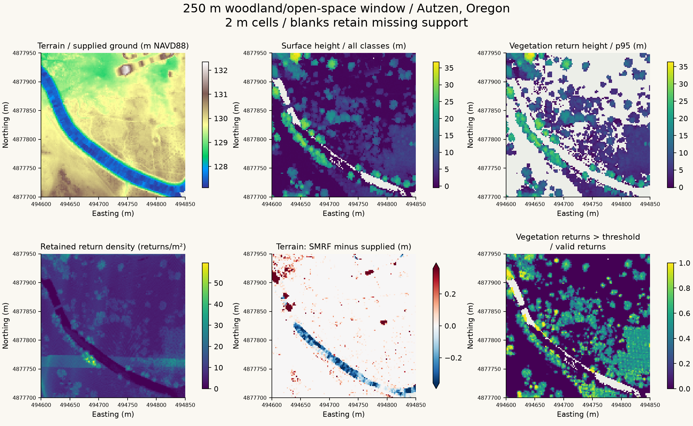

# lidar-forest-structure

**LAS/LAZ to terrain, vegetation structure and a documented quality audit.** 

A 250 m woodland/open-space window near Autzen Stadium, Oregon demonstrates ingestion, coordinate handling, filtering, ground reclassification and feature extraction. Supplied ground labels are compared with PDAL SMRF, with missing support and artifacts preserved.

## Reproduce

Install Conda and Quarto; run from the repository root:

~~~bash
conda env create -f environment.yml
conda activate lidar-forest-structure
lidar-forest download
lidar-forest run
lidar-forest validate
python -m unittest discover -s tests -v
python scripts/execute_notebook.py
quarto preview
~~~

The 74 MB source is pinned to an upstream commit and verified by SHA-256. The report also renders from committed figures/manifest without raw data.

Existing output directories are never overwritten. For another run use:

~~~bash
lidar-forest run --output work/second-run
~~~

Processing refreshes report/assets/; review changes before committing.

## Evidence to inspect

| Path | Role |
|---|---|
| lidarforest/ | CLI, coordinate validation, interpolation, PDAL and exports |
| config/example.yml | AOI, buffer, resolution and parameters |
| data/source.json | Source, attribution and reuse notes |
| notebooks/01_walkthrough.ipynb | Clean walkthrough |
| report/ | Methods, actual findings, figures and manifest |
| tests/ | Numerical, coordinate and PDAL checks |
| docs/ | Decisions, QC checklist and tested environment |
| .github/workflows/ | CI and manual publishing |

The workflow transforms horizontal international feet into UTM metres and separately converts NAVD88 US survey feet. It preserves original labels, uses support-limited interpolation, reports negative heights, exports aligned GeoTIFFs and a LAZ with extra dimensions, and records reproducibility metadata. Raw/derived point clouds and local rasters are excluded from Git.

## Interpretation and attribution

Mixed urban/woodland data is not a representative forest inventory. Ground-label agreement is not accuracy. Return fractions are not canopy cover, biomass, fuel load or fire risk. No independent field validation is included.

The [upstream README](https://github.com/PDAL/data/blob/ce0024257c573526389c4db9ab26e82739b8aaa9/autzen/README.md) credits 2010 data to Aaron Reyna/Watershed Sciences and 2021 classifications to Max Sampson/Hobu. No separate data license is specified there; source/subset point clouds are not redistributed here.                                                                                     

Original code is MIT licensed; third-party data is not relicensed.                                                                    
