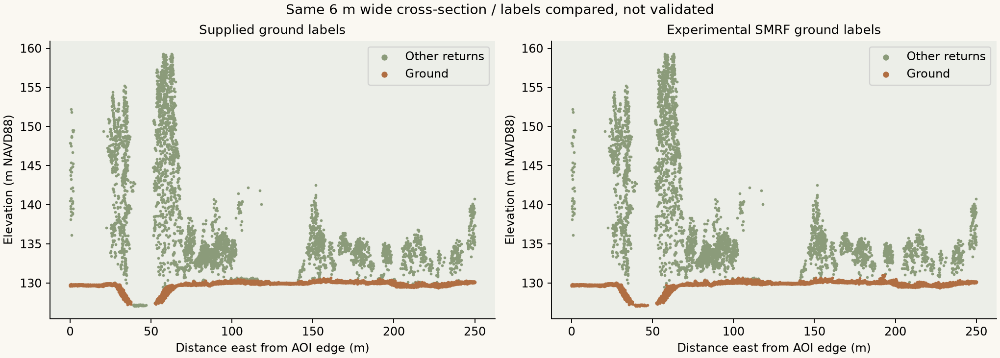
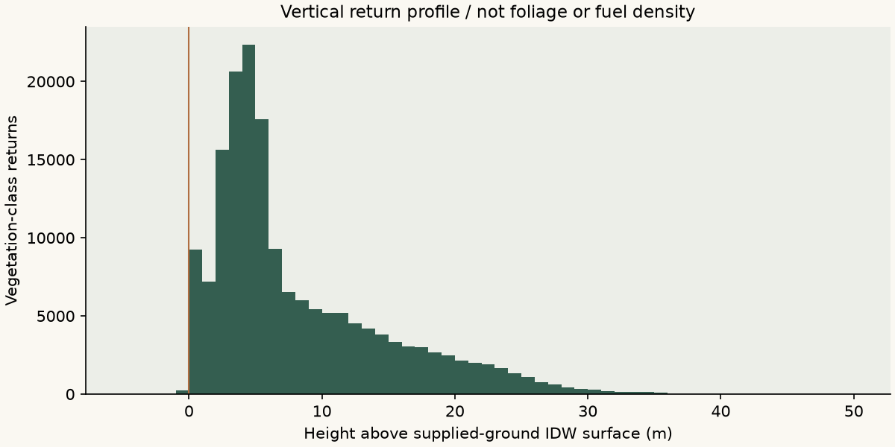

## What changed between ground branches?

The supplied labels and SMRF disagree on **11,738 of 539,028 returns** (2.18%). This is disagreement, **not accuracy**: independent reference labels/checkpoints were not available.

| Ground-label combination | AOI returns |
|---|---:|
| both ground | 359,817 |
| provider only ground | 198 |
| smrf only ground | 11,540 |
| neither ground | 167,473 |

Both terrain branches use identical gridding/support rules. SMRF-minus-supplied terrain has a median difference of **0.000 m**, and a range of **-0.750 to 3.738 m** among supported cells. A median near zero does not erase local differences.

The map limits colors to the 98th percentile of absolute differences for visibility; saturated colors may represent more extreme values. The manifest retains the full range. More ground labels or filled cells does not necessarily mean better terrain.

## Missing support is a result

Supplied-ground terrain supports **15,608 of 15,625 cells**. Vegetation p95 is available in **7,686 cells**. Blank vegetation cells do not establish absent vegetation.

| Internal check | Count |
|---|---:|
| negative surface height cells | 380 |
| negative vegetation hag returns | 249 |
| vegetation hag over 60m returns | 0 |
| unsupported point hag | 255 |
| empty return cells | 510 |

Small negative surface heights can arise because cell maximum elevations and terrain estimates are evaluated at different locations on sloping ground. Negative point HAG can also reflect interpolation, noise or labeling. Values remain visible rather than clamped.

The 60 m flag is diagnostic, not a universal height limit. Zero flagged tall returns does not certify correctness.

## What vegetation products measure

Profiles count returns, not leaves, vegetation mass or fuel. Sampling depends on sensor geometry, occlusion, season and detection. Cell p95 can rely on few returns: inspect local support. The histogram view spans −5 to 50 m; CSV bins preserve tails.

All-class surface height can contain structures. Vegetation p95 uses supplied classes 3/4/5 and inherits their errors. Return fraction above 2 m is not canopy cover, understory density or ladder-fuel continuity.

## Verification and next evidence

Numerical tests cover interpolation, grid orientation, boundaries and missing support. Coordinate tests cover separate units, round-trip conversion and rejection of incomplete metadata. A synthetic flat-ground/elevated-object fixture exercises actual PDAL SMRF. The real-data run checks LAS/LAZ counts, compound CRS, raster alignment/nodata, hashes and comparison reconciliation.

Hashes establish file integrity, not scientific validity. Independent checkpoints, reviewed labels and field plots would be needed for accuracy and ecological assessment.

[Download the run manifest](assets/run.json) · [Reproduce it](reproduce.qmd)
